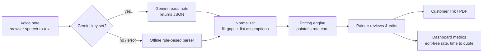

# QuoteVoice

**A painter talks through a job and gets an itemized quote, priced with their own rates, in about three minutes.**

Live app: https://saif-byte.github.io/quotevoice/

## The problem

Residential painters walk through a job, take rough notes, then type the quote at night and send it a day or two later.
Homeowners usually collect several bids, and the painter who answers first and looks professional often wins.
Quoting is unpaid admin that eats evenings and loses jobs.

## What QuoteVoice does

1. **Record** the walkthrough as a voice note (or type it) right after the visit.
2. **AI reads the note** and turns it into a structured job: rooms, sizes, surfaces, prep, coats, who supplies paint.
3. **Gaps are filled and flagged.** Anything the painter didn't say (ceiling height, room size, coats) gets a sensible
   default, and every default is shown as "check this" before the quote goes out.
4. **Code prices the job** using the painter's own rate card. The AI never sets a price.
5. **Review, finalize, send.** The painter edits any line, optionally adds a discount (% or $, with a reason shown to
   the customer), then sends a link the homeowner can open on any phone or print to PDF.
6. **Dashboard** tracks quotes sent, money waiting on an answer, win rate, time to quote, and how often the AI's draft
   was sent without edits.

## Try it in 2 minutes

1. Open the live app and click **Explore with sample data** to see the dashboard.
2. Click **New quote**, pick a sample note (or press **Start recording** in Chrome and talk), then **Build quote**.
3. Check the yellow "Check these" list and the rooms, then **Price this job**.
4. Change a line if you want, then **Finalize quote**.
5. Click **Copy customer link** and open it in a private window: that's what the homeowner sees.

## How it works



**Key design decision: the AI only reads, code does the math.** A wrong number on a signed estimate costs the painter
money. Language models are good at understanding messy speech but can invent numbers. So the model's single job is
speech → structured facts (with `null` for anything not said), and tested code does all arithmetic and pricing.

| Step | Where it runs | Cost |
| --- | --- | --- |
| Speech-to-text | Browser Web Speech API (Chrome, Edge, Safari) | Free |
| Reading the note | Google Gemini free tier, or the offline parser | Free |
| Pricing | TypeScript in the browser | Free |
| Storage | Browser `localStorage` | Free |
| Customer link | Quote compressed into the URL, no server | Free |
| Hosting | GitHub Pages, deployed by GitHub Actions | Free |

## Measuring AI quality

The project plan picks one metric to compete on: **AI line items sent without edits** (target 80%).

- **In the app:** every quote stores the AI's first draft and the final version. The dashboard shows the share of AI
  lines kept as-is, and how often the painter moved the total by more than 10%.
- **Offline eval:** `eval/cases.ts` holds hand-labeled voice notes. `npm run eval` scores extraction field by field.

| Test set | What it is | Score |
| --- | --- | --- |
| Original cases | Notes written alongside the parser | 163/163 (100%) |
| Field-test cases | Misreads found when an agent used the app as a painter; 73.3% before fixes | 116/116 (100%) |
| Held-out cases | Same kinds of phrasing, reworded after the fixes, never tuned on | 38/39 (97.4%) |

The held-out score is the honest one: the first two sets were used to build and fix the parser. The next step is
adding real voice notes recorded during painter interviews. To score Gemini too:

```bash
GEMINI_API_KEY=your-key npm run eval
```

## Turning on the AI (optional, free)

1. Get a free key at https://aistudio.google.com/apikey
2. In the app, open **Settings → AI reading** and paste it.

The key is saved only in your browser and sent only to Google. On Google's free tier, requests may be used to improve
their models, so avoid real customer details while testing.

## Run it locally

```bash
npm install
npm run dev      # http://localhost:5173
npm test         # unit tests + eval
npm run build    # production build in dist/
```

## Project structure

```
src/
  lib/
    types.ts       data model: RawJob → JobSpec → LineItem → Quote
    parser.ts      offline rule-based reader (fallback + baseline)
    gemini.ts      AI reader: prompt + JSON schema for Gemini
    extract.ts     picks AI or parser, falls back on error
    normalize.ts   fills gaps, records every assumption
    pricing.ts     areas, coats, rate card → line items
    metrics.ts     dashboard numbers (edit-free rate, win rate…)
    share.ts       customer links with the quote inside the URL
  hooks/useSpeech.ts   browser speech recognition
  pages/           Dashboard, NewQuote (3 steps), QuoteView, SharedView, Settings, HowItWorks
eval/              labeled voice notes + scoring
docs/BUILD_STEPS.md  how this was built, step by step, and how to explain it
```

## Field test (2026-10-30)

An agent used the live app as "Mike Delgado", a residential painter, and reported 15 bugs. Fixed in v1.1:

- Editing a quote, then clicking New quote, no longer overwrites the old quote.
- The reader now handles "ceiling and trim are staying as is", "ceilings are like fourteen foot", spoken corrections
  ("fourteen by twelve no wait twelve by twelve"), past or turned-down work ("we did their kitchen last year", "she asked
  about the garage door"), landmarks ("the powder room off the kitchen"), whole-house statements, and wallpaper borders.
- A color change adds a coat to the walls only, not the ceiling.
- Negative numbers are blocked, $0 quotes can't be finished, and leaving an unsaved quote asks first.
- The customer quote says when the customer supplies paint, and phone and email are tappable.
- Business details start blank instead of an example company's.
- The dashboard leads with money (open, won, follow-ups due); AI-quality numbers moved to their own section.

Accounts, sync, short links and online acceptance were added next (see below). Still open: sending by text or email.

## Accounts, sync and online acceptance (Supabase, free tier)

Signing in is optional. Without an account everything stays in the browser, exactly like v1.

| Feature | How it works |
| --- | --- |
| Accounts | Email + password via Supabase Auth |
| Sync | Quotes and rates saved to Postgres; a cached copy keeps the app fast and usable offline |
| Privacy | Row-level security: each painter can only read and change their own rows |
| Short customer link | `…/#/q/<16-character code>`; the database function returns only the customer copy |
| Accept online | Homeowner types their name; a database function records it once and marks the quote Won |
| Server-side AI | Edge Function `read-note` calls Gemini with a server secret, so no key is needed in the browser |
| Never pauses | A daily GitHub Action calls a `ping` function, because free projects pause after 7 days idle |

Database schema and policies: `supabase/migrations/`. Edge Function: `supabase/functions/read-note/`.
`src/lib/geminiCore.ts` is shared by the browser and the function (`npm run sync:function` copies it; a test checks
they match).

## Limits of this version

- Interior painting only; cabinets, exterior and specialty finishes are flagged but not priced.
- Without signing in, data lives in one browser.
- Voice input needs Chrome, Edge or Safari.
- Default rates are examples, not market advice. Painters set their own in Settings.

## What's next

- Run the 6–8 painter interviews (experiment E1) and add their real voice notes to the eval set.
- Score Gemini on the eval set (`GEMINI_API_KEY=… npm run eval`) and compare it with the built-in reader.
- Send quotes by text or email from the app, and notify the painter when a quote is accepted.
- Photo capture on site, attached to the quote.
